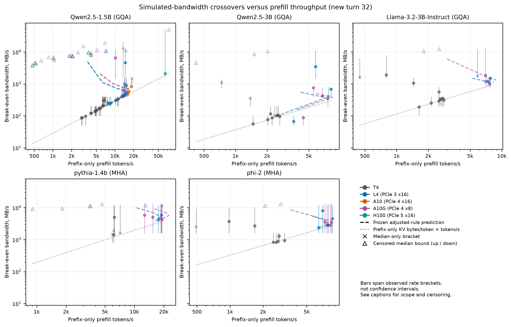

# Phase three: preregistered transfer across GPUs

Predictions were frozen from short, independent calibration before each GPU sweep. No coefficient was refitted from sweep results. All paced rates below are **simulated bandwidth**, using the unchanged phase-two reference timing functions.

Timing records: 16079; invalid: 0; missing registered cells: 52. Conservative main cost including reservations: $4.8392; optional H100: $2.1976. These are list-price estimates including CPU, capped memory, initialization and infrastructure, not an invoice.

The optional H100 input received a cancellation signal before its sweep finished. Complete cells remain scored against the frozen registration; partial and unstarted cells remain archived and unscored. Every unfinished cell is listed in [phase3_dropped_cells.json](../outputs/phase3_dropped_cells.json). The initiating actor and root cause of the cancellation are unknown. No second allocation was requested, and the full H100 reservation is retained.

## Frozen prediction scorecard

| Observed board / allocated name | Region or session | Correct / resolved decisions | Unresolved | Complete timing cells | Median absolute TTFT error, ms | Median absolute relative error |
| --- | --- | --- | --- | --- | --- | --- |
| L4 (PCIe 3 x16) / NVIDIA L4 | all | 574 / 636 | 13 | 767 | 3.203 | 4.6% |
| L4 (PCIe 3 x16) / NVIDIA L4 | anchor | 246 / 248 | 5 | 299 | 2.822 | 3.3% |
| L4 (PCIe 3 x16) / NVIDIA L4 | interpolation | 231 / 289 | 8 | 351 | 2.981 | 4.5% |
| L4 (PCIe 3 x16) / NVIDIA L4 | extrapolation | 97 / 99 | 0 | 117 | 4.007 | 8.7% |
| L4 (PCIe 3 x16) / NVIDIA L4 | session: phase3-l4-controls | 193 / 201 | 8 | 247 | 1.506 | 1.5% |
| L4 (PCIe 3 x16) / NVIDIA L4 | session: phase3-l4-main-1 | 188 / 216 | 4 | 260 | 3.681 | 6.2% |
| L4 (PCIe 3 x16) / NVIDIA L4 | session: phase3-l4-main-2 | 193 / 219 | 1 | 260 | 3.654 | 6.2% |
| A10 (PCIe 4 x16) / NVIDIA A10 | all | 192 / 206 | 14 | 260 | 2.040 | 3.9% |
| A10 (PCIe 4 x16) / NVIDIA A10 | anchor | 59 / 63 | 3 | 78 | 2.275 | 5.0% |
| A10 (PCIe 4 x16) / NVIDIA A10 | interpolation | 96 / 105 | 5 | 130 | 2.308 | 3.6% |
| A10 (PCIe 4 x16) / NVIDIA A10 | extrapolation | 37 / 38 | 6 | 52 | 1.341 | 3.4% |
| A10 (PCIe 4 x16) / NVIDIA A10 | session: phase3-a10-main-1 | 192 / 206 | 14 | 260 | 2.040 | 3.9% |
| A10G (PCIe 4 x8) / NVIDIA A10G | all | 398 / 426 | 3 | 507 | 5.758 | 10.8% |
| A10G (PCIe 4 x8) / NVIDIA A10G | anchor | 178 / 187 | 0 | 221 | 5.094 | 10.4% |
| A10G (PCIe 4 x8) / NVIDIA A10G | interpolation | 170 / 185 | 2 | 221 | 5.511 | 10.5% |
| A10G (PCIe 4 x8) / NVIDIA A10G | extrapolation | 50 / 54 | 1 | 65 | 8.371 | 22.0% |
| A10G (PCIe 4 x8) / NVIDIA A10G | session: phase3-a10-controls | 193 / 209 | 0 | 247 | 5.031 | 8.2% |
| A10G (PCIe 4 x8) / NVIDIA A10G | session: phase3-a10-main-2 | 205 / 217 | 3 | 260 | 6.433 | 13.1% |
| H100 (PCIe 5 x16) / NVIDIA H100 80GB HBM3 | all | 20 / 21 | 1 | 26 | 6.579 | 2.6% |
| H100 (PCIe 5 x16) / NVIDIA H100 80GB HBM3 | anchor | 11 / 11 | 0 | 13 | 0.332 | 1.8% |
| H100 (PCIe 5 x16) / NVIDIA H100 80GB HBM3 | extrapolation | 9 / 10 | 1 | 13 | 9.999 | 2.9% |
| H100 (PCIe 5 x16) / NVIDIA H100 80GB HBM3 | session: phase3-h100-main | 20 / 21 | 1 | 26 | 6.579 | 2.6% |

The calibrated rule transfers imperfectly: most resolved decisions are correct, but median errors conceal large native-context extrapolation failures. The throughput-ratio hypothesis has counterexamples among resolved brackets; broad compatibility below is evidence of approximate transfer, not a universal scaling law.

Resolved decisions require the paired-round bootstrap interval for path-minus-recompute TTFT to exclude zero. Errors include prefix-only, recompute and resident-hit baselines; decisions include resident hit and reload paths. The unthrottled pinned path is counted once. Cell counts are descriptive and are not independent trials. Anchor/interpolation/extrapolation refer to the calibration length range.

Largest absolute TTFT prediction errors (all conditions, without refitting):

| Requested GPU | Model | Prefix / new turn | Condition | Predicted / observed, ms | Region |
| --- | --- | --- | --- | --- | --- |
| A10G (PCIe 4 x8) | Qwen2.5-3B | 32736 / 32 | recompute | 8041.10 / 13914.56 | extrapolation |
| L4 (PCIe 3 x16) | Qwen2.5-3B | 32736 / 32 | recompute | 13088.36 / 18022.90 | extrapolation |
| L4 (PCIe 3 x16) | Qwen2.5-3B | 32736 / 32 | prefix_only | 13980.51 / 9148.16 | extrapolation |
| A10G (PCIe 4 x8) | Qwen2.5-3B | 32736 / 32 | prefix_only | 8604.92 / 7395.64 | extrapolation |
| L4 (PCIe 3 x16) | Qwen2.5-1.5B | 16384 / 32 | prefix_only | 2452.11 / 1910.04 | extrapolation |

## Hardware and provenance

| Run | Allocated GPU / capability | Driver and PCIe snapshot | Torch / Transformers / Python | Wall seconds |
| --- | --- | --- | --- | --- |
| calibration-l4-main | NVIDIA L4 / [8, 9] | NVIDIA L4, 610.57.04, 23034 MiB, GPU-e81b9614-e326-e966-2de2-bd2eea65bf53, 1, 3, 16, 16 | 2.11.0+cu130 / 4.51.3 / 3.13.3 | 63.4 |
| calibration-a10-main | NVIDIA A10 / [8, 6] | NVIDIA A10, 610.57.04, 23028 MiB, GPU-54aadef2-7086-bba6-c93e-18bb4c870e71, 1, 4, 16, 16 | 2.11.0+cu130 / 4.51.3 / 3.13.3 | 42.5 |
| calibration-a10-controls | NVIDIA A10 / [8, 6] | NVIDIA A10, 610.57.04, 23028 MiB, GPU-fa14a7e0-0bbb-2ef8-f305-f17c2f27540c, 1, 4, 16, 16 | 2.11.0+cu130 / 4.51.3 / 3.13.3 | 132.5 |
| calibration-l4-controls | NVIDIA L4 / [8, 9] | NVIDIA L4, 610.57.04, 23034 MiB, GPU-bf76c1d8-ce2f-d6ab-5358-ff2599d7a87b, 1, 3, 16, 16 | 2.11.0+cu130 / 4.51.3 / 3.13.3 | 169.2 |
| a10-main-1 | NVIDIA A10 / [8, 6] | NVIDIA A10, 610.57.04, 23028 MiB, GPU-ab307190-207f-879a-97c1-ca395e78d4bb, 1, 4, 16, 16 | 2.11.0+cu130 / 4.51.3 / 3.13.3 | 1097.4 |
| a10-controls | NVIDIA A10G / [8, 6] | NVIDIA A10G, 610.57.04, 23028 MiB, GPU-8787ef13-8c5f-e6fe-570b-e94a3f692c42, 1, 4, 8, 16 | 2.11.0+cu130 / 4.51.3 / 3.13.3 | 2095.0 |
| a10-main-2 | NVIDIA A10G / [8, 6] | NVIDIA A10G, 610.57.04, 23028 MiB, GPU-968b001b-c728-1ed6-a6b6-ca4a2e884ac2, 1, 4, 8, 16 | 2.11.0+cu130 / 4.51.3 / 3.13.3 | 1097.8 |
| l4-main-1 | NVIDIA L4 / [8, 9] | NVIDIA L4, 610.57.04, 23034 MiB, GPU-d544fdb7-faaa-8082-6c69-c4721fcf7698, 1, 3, 16, 16 | 2.11.0+cu130 / 4.51.3 / 3.13.3 | 1191.6 |
| l4-main-2 | NVIDIA L4 / [8, 9] | NVIDIA L4, 610.57.04, 23034 MiB, GPU-a5c2e13c-cf5d-7c01-2d51-f783f0d02f90, 1, 3, 16, 16 | 2.11.0+cu130 / 4.51.3 / 3.13.3 | 1202.7 |
| l4-controls | NVIDIA L4 / [8, 9] | NVIDIA L4, 610.57.04, 23034 MiB, GPU-673c2d62-7e2c-f299-46e4-c19009c8b8e4, 1, 3, 16, 16 | 2.11.0+cu130 / 4.51.3 / 3.13.3 | 2292.1 |
| h100-single-session | NVIDIA H100 80GB HBM3 / [9, 0] | NVIDIA H100 80GB HBM3, 610.57.04, 81559 MiB, GPU-46e2d0bf-ace9-06a9-bf8a-99fae347c91d, 5, 5, 16, 16 | 2.11.0+cu130 / 4.51.3 / 3.13.3 | Unavailable after cancellation |

Modal names its Ampere request `A10`; the actual GPU name above is authoritative. A10 and A10G names within that service tier are retained separately in the session scorecards. GPU UUIDs, exact driver/runtime versions, clocks, CPU/RAM and filesystem capacity are retained per run. The last snapshot fields are current/max PCIe generation and current/max link width; timing telemetry supplies the active-link values. All measurements use fp16 and efficient/math SDPA, with FlashAttention disabled. The full scheduling difference and protected function hashes are in `outputs/phase3_provenance.json`; each executed source and adapter hash is also in the canonical records.

| Source | SHA-256 |
| --- | --- |
| Historical T4 submission | `085bd2aa139e9574d0e951d57535a7095ad07b547f9ea479c239046a0acacae7` |
| Current phase-two reference | `73dd9a4fdd9d43191673ecf07cfb763b3600f8fa8144a0b82951b565b7b68793` |
| Platform scheduling template, before run-specific configuration | `b40c09f50bb30f2252bd4f6d15e6e04cc3551b0343d0a960049507f1cd08a85e` |

Whole-file hashes differ because of scheduling and run configuration; all six protected timing, transfer, forward, request, read and eviction functions match the historical T4 source byte for byte. The canonical source-provenance records retain each executed configured-source hash and adapter hash.

| Model | Attention family | KV bytes/token, fp16 |
| --- | --- | --- |
| Qwen2.5-1.5B | GQA | 28672 |
| Qwen2.5-3B | GQA | 36864 |
| Llama-3.2-3B-Instruct | GQA | 114688 |
| pythia-1.4b | MHA | 196608 |
| phi-2 | MHA | 327680 |

The T4 reference used Python 3.13.16, Torch 2.11.0+cu130 and Transformers 4.51.3. Python patch and driver differences from the Modal allocations are explicit platform differences. KV footprints are computed from each config and independently checked against cache tensors.

## Crossover bandwidth and the throughput hypothesis

The complete per-session, per-model, per-length predictions and observed brackets are in [phase3_crossovers.csv](../outputs/phase3_crossovers.csv). Brackets are measured adjacent simulated-rate cells; interpolation is supplementary and assumes local inverse-bandwidth linearity. Censored bounds describe medians and are not confidence limits. A “median only” bracket has an unresolved endpoint interval.

| GPU / session | Model | Prefix / new turn | Predicted B*, MB/s | Observed simulated-bandwidth bracket, MB/s | Prefill tokens/s | Pinned / pageable H2D, MB/s |
| --- | --- | --- | --- | --- | --- | --- |
| A10G (PCIe 4 x8) / phase3-a10-controls | pythia-1.4b | 1024 / 32 | 5629.90 | [1600.0, unthrottled] target / [1594.5, 13346.0] achieved | 18622.2 | 13351.68 / 12920.97 |
| A10G (PCIe 4 x8) / phase3-a10-controls | Qwen2.5-3B | 1024 / 32 | 379.48 | [200.0, 400.0] target / [199.3, 396.9] achieved | 7596.3 | 13181.95 / 12117.60 |
| A10G (PCIe 4 x8) / phase3-a10-controls | phi-2 | 1024 / 32 | 3355.09 | [1600.0, unthrottled] target / [1596.1, 13278.8] achieved | 8223.0 | 13132.47 / 12478.47 |
| A10G (PCIe 4 x8) / phase3-a10-controls | Llama-3.2-3B-Instruct | 1024 / 32 | 1137.03 | [800.0, 1600.0] target / [797.6, 1588.6] achieved | 7670.8 | 13318.57 / 12654.65 |
| A10 (PCIe 4 x16) / phase3-a10-main-1 | Qwen2.5-1.5B | 1024 / 32 | 700.91 | [800.0, 1600.0] target / [795.2, 1544.2] achieved | 18391.1 | 24167.13 / 14624.98 |
| A10 (PCIe 4 x16) / phase3-a10-main-1 | Qwen2.5-1.5B | 16384 / 32 | 297.39 | [200.0, 400.0] target / [199.9, 399.7] achieved | 11436.7 | 24932.47 / 8726.93 |
| A10G (PCIe 4 x8) / phase3-a10-main-2 | Qwen2.5-1.5B | 1024 / 32 | 700.91 | [400.0, 800.0] target / [396.2, 791.0] achieved | 14178.2 | 13115.34 / 12217.80 |
| A10G (PCIe 4 x8) / phase3-a10-main-2 | Qwen2.5-1.5B | 16384 / 32 | 297.39 | [200.0, 400.0] target / [199.9, 399.7] achieved | 11058.3 | 13376.16 / 13060.92 |
| H100 (PCIe 5 x16) / phase3-h100-main | Qwen2.5-1.5B | 1024 / 32 | Unidentified | above tested achieved rates (bound only) | 73677.8 | 51185.32 / 16770.28 |
| H100 (PCIe 5 x16) / phase3-h100-main | Qwen2.5-1.5B | 16384 / 32 | 1435.63 | [1600.0, unthrottled] target / [1597.6, 53249.7] achieved | 64193.1 | 53270.42 / 10998.05 |
| L4 (PCIe 3 x16) / phase3-l4-controls | pythia-1.4b | 1024 / 32 | 5271.60 | [1600.0, unthrottled] target / [1590.8, 12147.3] achieved | 18924.7 | 12145.07 / 4524.08 |
| L4 (PCIe 3 x16) / phase3-l4-controls | Qwen2.5-3B | 1024 / 32 | 370.73 | [400.0, 800.0] target / [396.5, 788.7] achieved (median only) | 7715.9 | 11903.21 / 4412.34 |
| L4 (PCIe 3 x16) / phase3-l4-controls | phi-2 | 1024 / 32 | 3047.89 | [1600.0, unthrottled] target / [1595.8, 12131.6] achieved | 7658.6 | 12155.13 / 4543.25 |
| L4 (PCIe 3 x16) / phase3-l4-controls | Llama-3.2-3B-Instruct | 1024 / 32 | 1123.78 | [800.0, 1600.0] target / [795.6, 1586.6] achieved | 7380.7 | 12112.89 / 4560.67 |
| L4 (PCIe 3 x16) / phase3-l4-main-1 | Qwen2.5-1.5B | 1024 / 32 | 640.49 | [800.0, 1600.0] target / [787.2, 1539.1] achieved | 15213.0 | 11738.23 / 7645.97 |
| L4 (PCIe 3 x16) / phase3-l4-main-1 | Qwen2.5-1.5B | 16384 / 32 | 197.48 | [200.0, 400.0] target / [200.0, 399.8] achieved | 8577.8 | 12170.68 / 6950.57 |
| L4 (PCIe 3 x16) / phase3-l4-main-2 | Qwen2.5-1.5B | 1024 / 32 | 640.49 | [800.0, 1600.0] target / [788.6, 1552.0] achieved (median only) | 14438.4 | 11801.22 / 7698.53 |
| L4 (PCIe 3 x16) / phase3-l4-main-2 | Qwen2.5-1.5B | 16384 / 32 | 197.48 | [200.0, 400.0] target / [199.9, 399.9] achieved | 8127.0 | 12158.73 / 7661.94 |
| T4 / phase2-llama-mirror-control | Llama-3.2-3B-Instruct | 1024 / 32 | 337.52 (descriptive) | [200.0, 400.0] target / [199.9, 399.8] achieved | 2587.8 | 12054.66 / 4547.78 |
| T4 / phase2-main-session-1 | Qwen2.5-1.5B | 1024 / 32 | 173.60 (descriptive) | [100.0, 200.0] target / [100.0, 199.8] achieved | 5581.6 | 10563.56 / 4519.71 |
| T4 / phase2-main-session-1 | Qwen2.5-1.5B | 16384 / 32 | 86.35 (descriptive) | [50.0, 100.0] target / [50.0, 100.0] achieved | 2957.9 | 12181.77 / 4500.82 |
| T4 / phase2-main-session-2 | Qwen2.5-1.5B | 1024 / 32 | 200.55 (descriptive) | [200.0, 400.0] target / [199.8, 399.0] achieved (median only) | 6285.1 | 11369.53 / 4757.27 |
| T4 / phase2-main-session-2 | Qwen2.5-1.5B | 16384 / 32 | 97.18 (descriptive) | [50.0, 100.0] target / [50.0, 100.0] achieved | 3346.3 | 12228.37 / 4446.68 |
| T4 / phase2-main-session-3 | Qwen2.5-1.5B | 1024 / 32 | 208.03 (descriptive) | [200.0, 400.0] target / [199.7, 399.0] achieved | 6469.7 | 11009.59 / 4539.00 |
| T4 / phase2-main-session-3 | Qwen2.5-1.5B | 16384 / 32 | 85.17 (descriptive) | [50.0, 100.0] target / [50.0, 100.0] achieved | 2880.2 | 12153.11 / 4555.46 |
| T4 / phase2-phi2-control | phi-2 | 1024 / 32 | 825.12 (descriptive) | [800.0, 1600.0] target / [799.8, 1599.2] achieved | 2636.3 | 12203.46 / 4537.06 |
| T4 / phase2-pythia-control | pythia-1.4b | 1024 / 32 | 1369.75 (descriptive) | [800.0, 1600.0] target / [799.4, 1598.7] achieved | 6139.9 | 11805.18 / 4591.86 |
| T4 / phase2-qwen-3b-control | Qwen2.5-3B | 1024 / 32 | 106.87 (descriptive) | [100.0, 200.0] target / [99.9, 199.8] achieved | 2552.2 | 10029.92 / 4634.85 |

“Unidentified” means the frozen adjusted denominator is nonpositive, so it predicts no finite bandwidth threshold.

| GPU | Compatible with at least one / all matched T4 sessions | Not ratio-resolved |
| --- | --- | --- |
| A10 (PCIe 4 x16) | 11 / 12 at least one; 10 / 12 all | 8 |
| A10G (PCIe 4 x8) | 20 / 24 at least one; 20 / 24 all | 15 |
| H100 (PCIe 5 x16) | 0 / 1 at least one; 0 / 1 all | 1 |
| L4 (PCIe 3 x16) | 25 / 27 at least one; 24 / 27 all | 32 |

At the complete H100 main-model prefix 16384, measured prefill is 21.70 times the matched T4 median; the frozen calibration expected 15.96 times. Its predicted B* is 1435.63 MB/s, versus [1600.0, unthrottled] target / [1597.6, 53249.7] achieved. The large gap to the unthrottled endpoint and incomplete second-model sweep make this a limited fast-GPU point.

The frozen hypothesis ratio is calibration-predicted new-GPU prefill throughput divided by matched T4 throughput. Compatibility compares it against resolved achieved-bandwidth crossover-ratio brackets, rather than dividing two formula outputs. Broad brackets and censored thresholds limit this test; compatibility does not establish equality. The adjusted threshold also depends on the new-turn baseline and fixed overhead, so an exact throughput ratio is not guaranteed.

## Real file paths and short contexts

| GPU | Model | Real path | Reload wins / resolved cells | Unresolved | Median signed / absolute prediction error, ms |
| --- | --- | --- | --- | --- | --- |
| A10 (PCIe 4 x16) | Qwen2.5-1.5B | file_raw_staged | 14 / 19 | 1 | 2.225 / 2.225 |
| A10 (PCIe 4 x16) | Qwen2.5-1.5B | file_torch_direct | 14 / 19 | 1 | 2.903 / 2.991 |
| A10G (PCIe 4 x8) | Qwen2.5-1.5B | file_raw_staged | 15 / 19 | 1 | -0.132 / 7.074 |
| A10G (PCIe 4 x8) | Qwen2.5-1.5B | file_torch_direct | 15 / 20 | 0 | -1.031 / 7.050 |
| A10G (PCIe 4 x8) | Qwen2.5-3B | file_raw_staged | 4 / 5 | 0 | -1.837 / 5.031 |
| A10G (PCIe 4 x8) | Qwen2.5-3B | file_torch_direct | 4 / 5 | 0 | -1.819 / 4.661 |
| A10G (PCIe 4 x8) | Llama-3.2-3B-Instruct | file_raw_staged | 3 / 4 | 0 | 5.859 / 6.679 |
| A10G (PCIe 4 x8) | Llama-3.2-3B-Instruct | file_torch_direct | 3 / 4 | 0 | 3.378 / 5.041 |
| A10G (PCIe 4 x8) | pythia-1.4b | file_raw_staged | 0 / 5 | 0 | 14.347 / 14.347 |
| A10G (PCIe 4 x8) | pythia-1.4b | file_torch_direct | 2 / 5 | 0 | 13.952 / 13.952 |
| A10G (PCIe 4 x8) | phi-2 | file_raw_staged | 4 / 5 | 0 | 25.102 / 25.102 |
| A10G (PCIe 4 x8) | phi-2 | file_torch_direct | 4 / 5 | 0 | 5.094 / 5.094 |
| H100 (PCIe 5 x16) | Qwen2.5-1.5B | file_raw_staged | 0 / 1 | 1 | -15.439 / 21.639 |
| H100 (PCIe 5 x16) | Qwen2.5-1.5B | file_torch_direct | 1 / 2 | 0 | 5.905 / 5.905 |
| L4 (PCIe 3 x16) | Qwen2.5-1.5B | file_raw_staged | 21 / 39 | 1 | 1.091 / 3.667 |
| L4 (PCIe 3 x16) | Qwen2.5-1.5B | file_torch_direct | 21 / 39 | 1 | 1.498 / 4.477 |
| L4 (PCIe 3 x16) | Qwen2.5-3B | file_raw_staged | 3 / 5 | 0 | 0.954 / 2.562 |
| L4 (PCIe 3 x16) | Qwen2.5-3B | file_torch_direct | 3 / 5 | 0 | 0.816 / 3.876 |
| L4 (PCIe 3 x16) | Llama-3.2-3B-Instruct | file_raw_staged | 1 / 3 | 1 | 1.126 / 1.126 |
| L4 (PCIe 3 x16) | Llama-3.2-3B-Instruct | file_torch_direct | 2 / 3 | 1 | 0.498 / 0.622 |
| L4 (PCIe 3 x16) | pythia-1.4b | file_raw_staged | 0 / 5 | 0 | -12.536 / 12.536 |
| L4 (PCIe 3 x16) | pythia-1.4b | file_torch_direct | 0 / 5 | 0 | -16.485 / 16.485 |
| L4 (PCIe 3 x16) | phi-2 | file_raw_staged | 0 / 5 | 0 | -21.251 / 21.251 |
| L4 (PCIe 3 x16) | phi-2 | file_torch_direct | 0 / 5 | 0 | -37.937 / 37.937 |

Both measured MHA models lose on both L4 file paths. On A10G (PCIe 4 x8), Phi-2 has file-reload wins and Pythia has direct-torch wins, so the T4 outcome does not transfer uniformly. A file-path win here concerns the full measured API TTFT, including CPU work and H2D transfer.

File predictions include independent read/deserialization/H2D legs, or the direct torch-load CPU leg plus H2D. These use the **local file API path (page-cache resident; physical reads not observed)**. Files are on local container scratch. The virtualized filesystem reports zero physical-read bytes in all summarized observations. Upstream [gVisor ignores fadvise advice](https://github.com/google/gvisor/blob/master/pkg/sentry/syscalls/linux/sys_file.go); the deployed runtime revision is not identified, so successful advisory calls cannot establish eviction. These host/storage paths differ from Kaggle, so changes in file wins cannot be assigned solely to GPU speed.

| Run | File observations | Nonzero physical-read counters | Median physical-read / file-byte ratio |
| --- | --- | --- | --- |
| phase3-calibration-l4-main | 45 | 0 | 0.000 |
| phase3-calibration-a10-main | 45 | 0 | 0.000 |
| phase3-calibration-a10-controls | 180 | 0 | 0.000 |
| phase3-calibration-l4-controls | 180 | 0 | 0.000 |
| phase3-a10-main-1 | 600 | 0 | 0.000 |
| phase3-a10-controls | 760 | 0 | 0.000 |
| phase3-a10-main-2 | 600 | 0 | 0.000 |
| phase3-l4-main-1 | 600 | 0 | 0.000 |
| phase3-l4-main-2 | 600 | 0 | 0.000 |
| phase3-l4-controls | 760 | 0 | 0.000 |
| phase3-calibration-h100-main | 45 | 0 | 0.000 |
| phase3-calibration-h100-pythia | 45 | 0 | 0.000 |
| phase3-h100-main | 115 | 0 | 0.000 |

| GPU | Main model, prefixes through 128 | Recompute wins / resolved pinned-path cells | Unresolved |
| --- | --- | --- | --- |
| A10 (PCIe 4 x16) | Separate turns and sessions | 3 / 4 | 2 |
| A10G (PCIe 4 x8) | Separate turns and sessions | 3 / 6 | 0 |
| H100 (PCIe 5 x16) | Separate turns and sessions | 0 / 0 | 0 |
| L4 (PCIe 3 x16) | Separate turns and sessions | 12 / 12 | 0 |

| GPU / session | New turn | Recompute wins at matched short prefixes | Reload wins | Unresolved |
| --- | --- | --- | --- | --- |
| L4 (PCIe 3 x16) / phase3-l4-main-1 | 32 | [16, 64, 128, 256] | [] | [] |
| L4 (PCIe 3 x16) / phase3-l4-main-1 | 256 | [16, 64, 128, 256] | [] | [] |
| L4 (PCIe 3 x16) / phase3-l4-main-2 | 32 | [16, 64, 128, 256] | [] | [] |
| L4 (PCIe 3 x16) / phase3-l4-main-2 | 256 | [16, 64, 128, 256] | [] | [] |
| A10 (PCIe 4 x16) / phase3-a10-main-1 | 32 | [16, 64, 128] | [] | [256] |
| A10 (PCIe 4 x16) / phase3-a10-main-1 | 256 | [] | [128, 256] | [16, 64] |
| A10G (PCIe 4 x8) / phase3-a10-main-2 | 32 | [16, 64, 128] | [256] | [] |
| A10G (PCIe 4 x8) / phase3-a10-main-2 | 256 | [] | [16, 64, 128, 256] | [] |
| T4 / phase2-main-session-1 | 32 | [16, 64, 128] | [256] | [] |
| T4 / phase2-main-session-1 | 256 | [] | [16, 64, 128, 256] | [] |
| T4 / phase2-main-session-2 | 32 | [16, 64, 128] | [256] | [] |
| T4 / phase2-main-session-2 | 256 | [] | [16, 64, 128, 256] | [] |
| T4 / phase2-main-session-3 | 32 | [16] | [256] | [64, 128] |
| T4 / phase2-main-session-3 | 256 | [] | [16, 64, 128, 256] | [] |

The regime table compares the main model at common prefixes through 256 tokens, using the real unthrottled pinned path. On L4, recomputation wins throughout those sampled short prefixes for both new-turn sizes; the T4 reference already favors reload at 256 tokens for a 32-token turn and across these prefixes for a 256-token turn. Thus L4 extends the observed recompute-favored regime. A10 and A10G have session- and turn-dependent boundaries rather than the same uniform shift. Short-prefix decisions can be dominated by host dispatch, allocation and the resident-hit baseline. The full score records retain every short-length decision and its paired interval; the sparse length grid cannot establish a continuous crossover length.

## Session spread and clock drift

| GPU | New turn | Median / maximum relative range of recompute session medians |
| --- | --- | --- |
| L4 (PCIe 3 x16) | 32 | 5.0% / 8.8% |
| L4 (PCIe 3 x16) | 256 | 4.4% / 7.3% |
| A10 (PCIe 4 x16) | Both turn sizes | One main session; within-board session spread is unidentified |
| A10G (PCIe 4 x8) | Both turn sizes | One main session; within-board session spread is unidentified |

T4 new turn 32: median recompute session range 12.3%, maximum 17.3%.
T4 new turn 256: median recompute session range 14.8%, maximum 21.0%.

| GPU / session | Prefix / new turn | Recompute median and within-session 95% CI, ms | Relative range: sessions on L4; A10 vs A10G allocation comparison |
| --- | --- | --- | --- |
| A10 (PCIe 4 x16) / phase3-a10-main-1 | 8192 / 256 | 601.105 [600.198, 603.250] | 5.5% |
| A10 (PCIe 4 x16) / phase3-a10-main-1 | 8192 / 32 | 583.895 [581.914, 589.018] | 6.6% |
| A10 (PCIe 4 x16) / phase3-a10-main-1 | 1024 / 32 | 57.128 [56.856, 57.296] | 26.0% |
| A10 (PCIe 4 x16) / phase3-a10-main-1 | 1024 / 256 | 77.307 [75.547, 80.526] | 22.0% |
| A10G (PCIe 4 x8) / phase3-a10-main-2 | 8192 / 256 | 634.850 [634.789, 634.913] | 5.5% |
| A10G (PCIe 4 x8) / phase3-a10-main-2 | 8192 / 32 | 623.803 [623.700, 623.861] | 6.6% |
| A10G (PCIe 4 x8) / phase3-a10-main-2 | 1024 / 256 | 96.388 [96.355, 96.627] | 22.0% |
| A10G (PCIe 4 x8) / phase3-a10-main-2 | 1024 / 32 | 74.176 [74.131, 74.363] | 26.0% |
| L4 (PCIe 3 x16) / phase3-l4-main-1 | 8192 / 256 | 785.423 [784.709, 792.838] | 7.0% |
| L4 (PCIe 3 x16) / phase3-l4-main-1 | 8192 / 32 | 760.407 [759.673, 766.897] | 6.9% |
| L4 (PCIe 3 x16) / phase3-l4-main-1 | 1024 / 32 | 70.224 [69.609, 70.711] | 4.4% |
| L4 (PCIe 3 x16) / phase3-l4-main-1 | 1024 / 256 | 92.021 [90.833, 102.130] | 6.0% |
| L4 (PCIe 3 x16) / phase3-l4-main-2 | 8192 / 256 | 842.538 [839.844, 847.195] | 7.0% |
| L4 (PCIe 3 x16) / phase3-l4-main-2 | 8192 / 32 | 814.803 [811.700, 820.760] | 6.9% |
| L4 (PCIe 3 x16) / phase3-l4-main-2 | 1024 / 256 | 97.752 [95.226, 103.637] | 6.0% |
| L4 (PCIe 3 x16) / phase3-l4-main-2 | 1024 / 32 | 73.406 [73.034, 79.484] | 4.4% |

| Run | Samples during timed intervals | SM MHz | Memory MHz | Temperature C | Power W | PCIe gen / width | Throttle reason bitmasks |
| --- | --- | --- | --- | --- | --- | --- | --- |
| phase3-calibration-l4-main | 11 | [1080.0, 1875.0] | [6251.0, 6251.0] | [76.0, 78.0] | [55.24, 72.58] | [3.0, 3.0] / [16.0, 16.0] | 0x0000000000000004 |
| phase3-calibration-a10-main | 8 | [1155.0, 1275.0] | [6251.0, 6251.0] | [53.0, 57.0] | [146.73, 157.74] | [4.0, 4.0] / [16.0, 16.0] | 0x0000000000000004 |
| phase3-calibration-a10-controls | 12 | [1065.0, 1395.0] | [6251.0, 6251.0] | [50.0, 58.0] | [83.74, 151.6] | [4.0, 4.0] / [16.0, 16.0] | 0x0000000000000004 |
| phase3-calibration-l4-controls | 17 | [930.0, 1905.0] | [6251.0, 6251.0] | [65.0, 73.0] | [41.94, 72.59] | [3.0, 3.0] / [16.0, 16.0] | 0x0000000000000004 |
| phase3-a10-main-1 | 922 | [885.0, 1695.0] | [6251.0, 6251.0] | [44.0, 54.0] | [57.89, 153.81] | [4.0, 4.0] / [16.0, 16.0] | 0x0000000000000000, 0x0000000000000004 |
| phase3-a10-controls | 1713 | [1710.0, 1710.0] | [6251.0, 6251.0] | [27.0, 52.0] | [59.1, 263.02] | [4.0, 4.0] / [8.0, 8.0] | 0x0000000000000000 |
| phase3-a10-main-2 | 934 | [1710.0, 1710.0] | [6251.0, 6251.0] | [31.0, 45.0] | [59.74, 246.69] | [4.0, 4.0] / [8.0, 8.0] | 0x0000000000000000 |
| phase3-l4-main-1 | 996 | [1005.0, 2040.0] | [6251.0, 6251.0] | [58.0, 80.0] | [28.94, 72.37] | [3.0, 3.0] / [16.0, 16.0] | 0x0000000000000000, 0x0000000000000004 |
| phase3-l4-main-2 | 1001 | [960.0, 2040.0] | [6251.0, 6251.0] | [71.0, 81.0] | [35.34, 73.71] | [3.0, 3.0] / [16.0, 16.0] | 0x0000000000000000, 0x0000000000000004 |
| phase3-l4-controls | 1827 | [870.0, 2040.0] | [6251.0, 6251.0] | [51.0, 76.0] | [28.09, 76.56] | [3.0, 3.0] / [16.0, 16.0] | 0x0000000000000000, 0x0000000000000004 |
| phase3-calibration-h100-main | 1 | [1980.0, 1980.0] | [2619.0, 2619.0] | [44.0, 44.0] | [409.38, 409.38] | [5.0, 5.0] / [16.0, 16.0] | 0x0000000000000000 |
| phase3-calibration-h100-pythia | 1 | [1980.0, 1980.0] | [2619.0, 2619.0] | [34.0, 34.0] | [317.12, 317.12] | [5.0, 5.0] / [16.0, 16.0] | 0x0000000000000000 |
| phase3-h100-main | 217 | [1890.0, 1980.0] | [2619.0, 2619.0] | [29.0, 43.0] | [125.98, 409.11] | [5.0, 5.0] / [16.0, 16.0] | 0x0000000000000000, 0x0000000000000004 |

Telemetry is sampled at approximately one-second intervals and can miss brief short-context trials. Randomized within-round condition order reduces ordering bias; telemetry association does not prove a cause for latency differences. GPU UUIDs in the ledger distinguish independent allocations from reused physical cards.

Bitmask `0x4` denotes software power-cap limiting, per the [NVIDIA NVML definitions](https://docs.nvidia.com/deploy/archive/R535/nvml-api/group__nvmlClocksEventReasons.html). Per-condition clock sample counts and medians are archived separately, since pooled timed intervals include rate-limiter sleeps.

A10 and A10G have only one main-model session each. The Ampere main sessions use A10 at PCIe 4 x16 and A10G at PCIe 4 x8. These allocation differences are the likely source of the previously reported service-tier spread. The slower session does not show lower sampled SM clocks, so clock frequency alone does not explain the recompute difference. This is a likely explanation, not a controlled attribution: host and allocation differences remain confounded.

## Rule of thumb and limits

Reload when `KV_bytes / effective_bandwidth + CPU_read_and_deserialization + fixed_overhead + resident_new_turn_TTFT < full_recompute_TTFT`; otherwise recompute, using locally calibrated baselines and treating near-zero savings as unresolved.

This is a single-request fp16 reference experiment, not a serving-throughput benchmark. It excludes cache creation, tokenization, network transfer and queueing; CPU caches and files already exist. The paced copy path simulates bandwidth and does not emulate network/storage latency distributions. Calibration extrapolation, host CPU differences, CUDA/driver differences, per-file eviction limits, two-session sampling, unpropagated calibration-fit uncertainty and model-specific context limits restrict transfer claims. Full configuration drops are in `configs/phase3_plan.json` and the optional H100 subset in `configs/phase3_h100_plan.json`; deviations are in `docs/NOTES.md`. The H100 calibration and sweeps share one allocation, so they provide no H100 across-session estimate. The optional Kaggle P100 retry was not requested in this phase. No production-path claim is made.
